# Inspiration Workbench · 灵感工作台

**Open many DeepSeek Harness sessions side by side, as draggable cards on a free canvas.**
**把多个 DSH 会话同时摊在一个画布上，像便利贴一样拖动、叠放、对比。**

[](https://www.npmjs.com/package/dsh-plugin-inspiration-workbench)
[](./LICENSE)
[](https://github.com/awesome-dsh-plugin/awesome-dsh-plugin)

DSH 一次只能打开一个会话：想同时看三条线的进展，只能来回切标签、丢掉上下文。
这个插件把会话变成卡片：可以并排看、叠成一摞、按状态分栏、把一张卡的结论引用/流水线喂给另一张卡。

---

## 截图 / Screenshots

| 多卡 + 折叠轮次 | 分栏看板 |
|---|---|
| 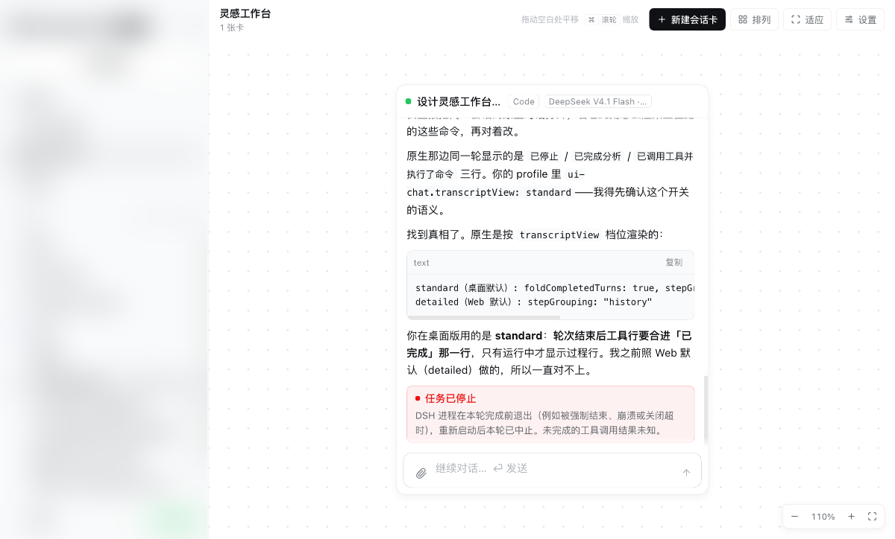 | 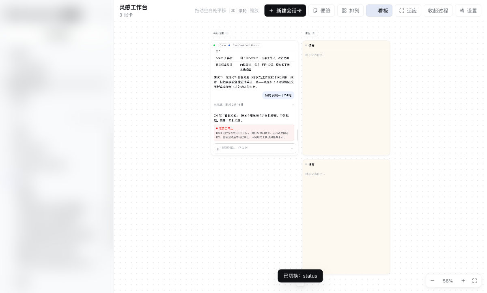 |

| 卡内搜索 | 批量操作 |
|---|---|
| 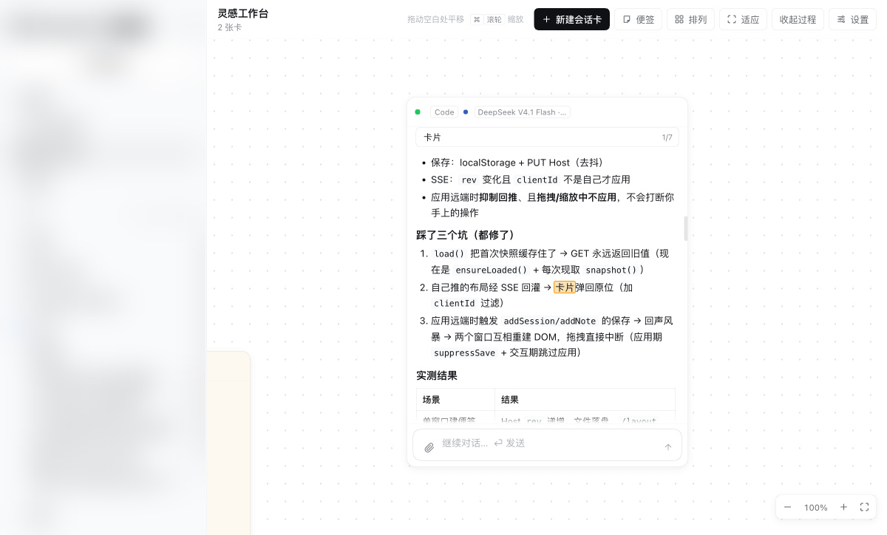 | 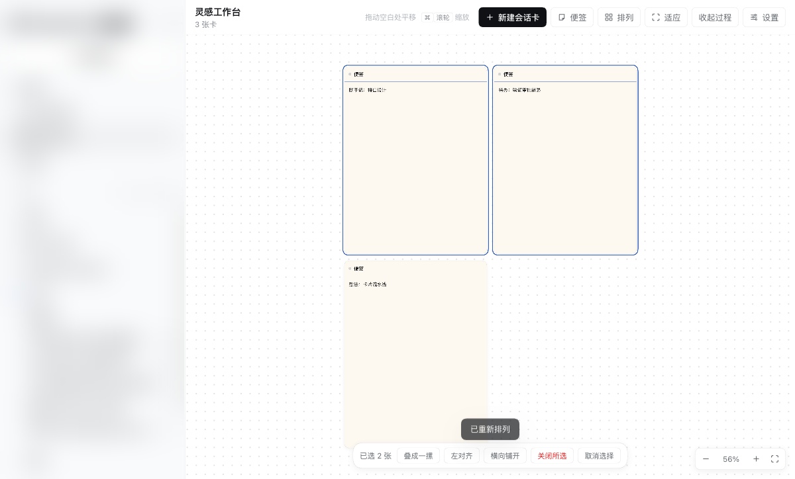 |

| 跨卡引用 | 卡片流水线 |
|---|---|
| 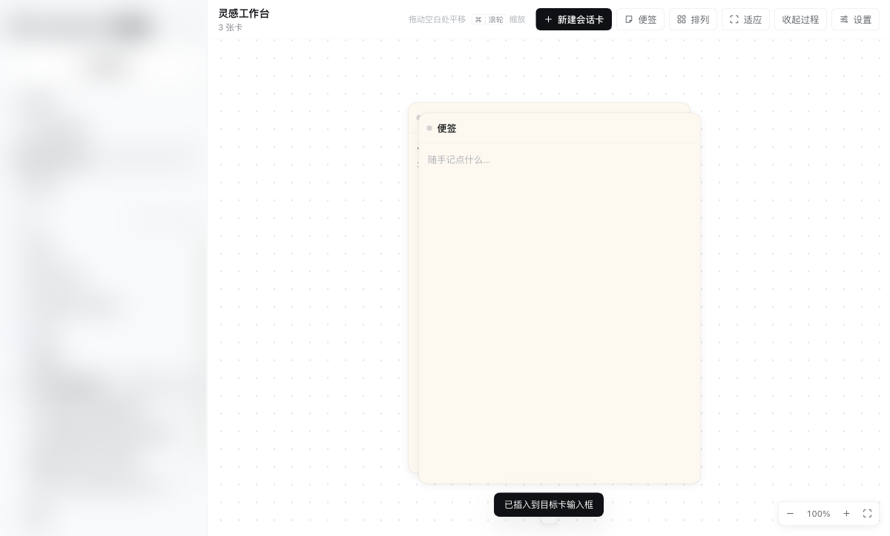 | 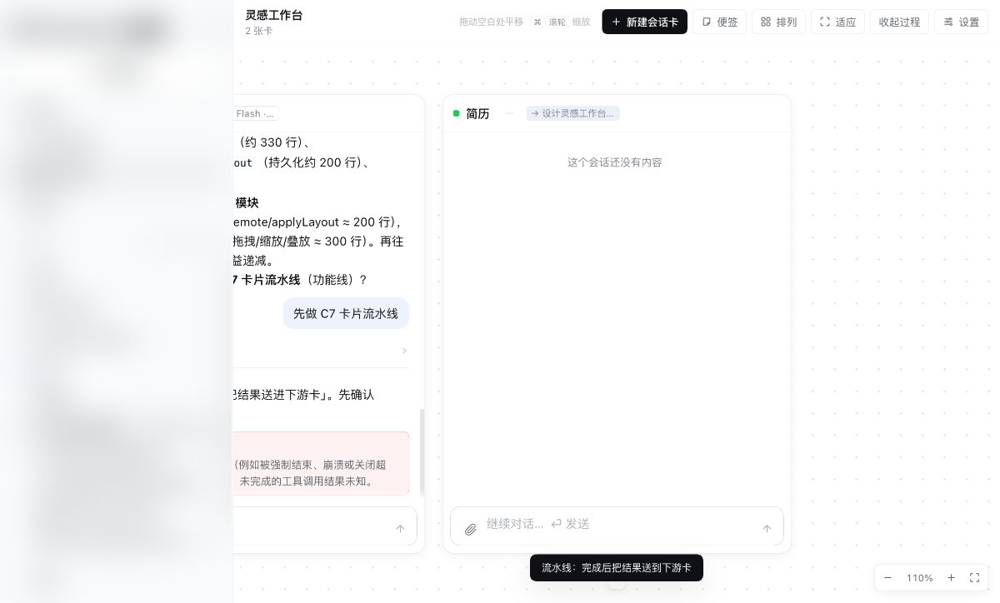 |

| 附件（模型真实读到文件） | 键盘可达 |
|---|---|
| 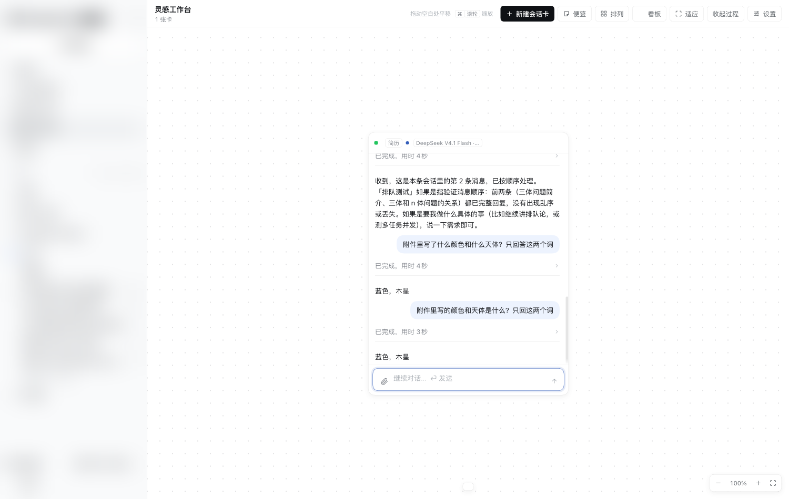 | 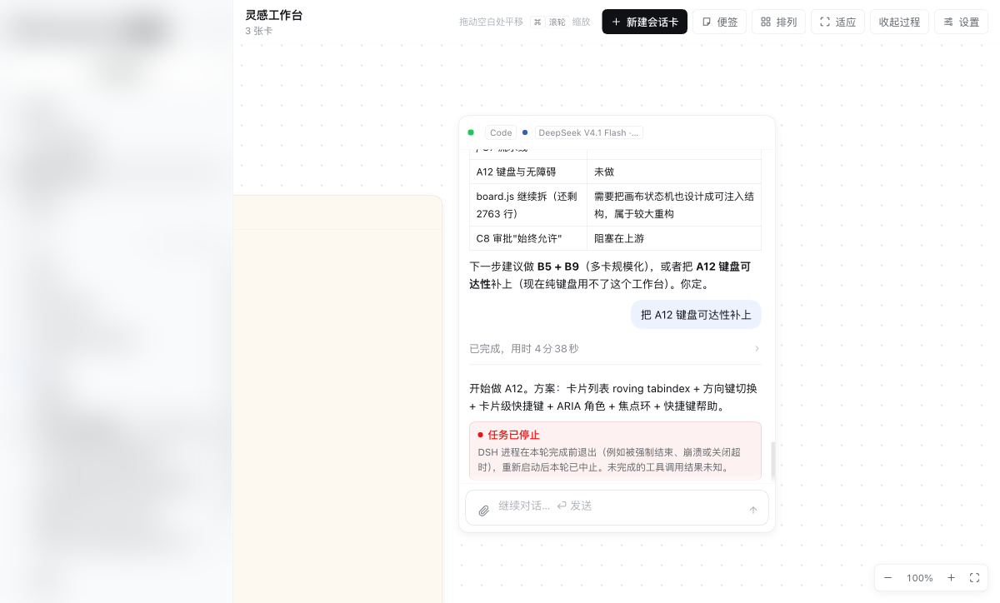 |

| 保存 / 切换画布 | 流水线：直接连线 |
|---|---|
| 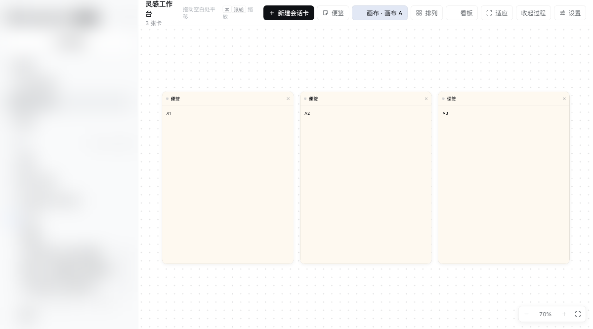 | 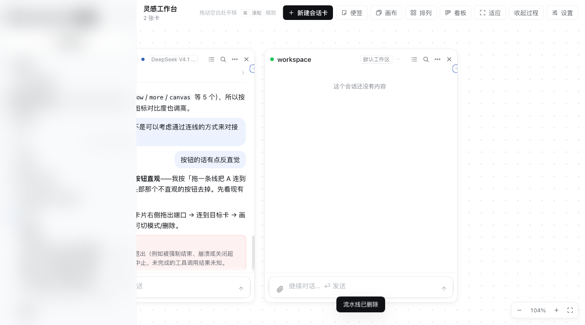 |

| 扇出到多个下游 | 下游可以是便签 |
|---|---|
| 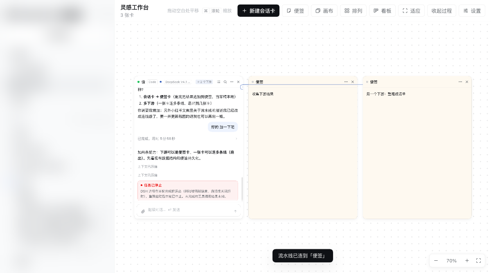 | 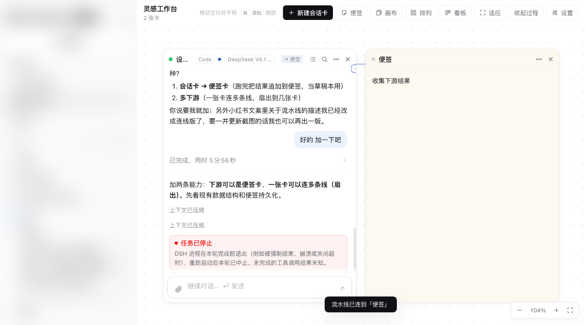 |

| 端口在四边中点，静止时是极淡的小点 | 悬停卡片后展开成带光环的把手 |
|---|---|
| 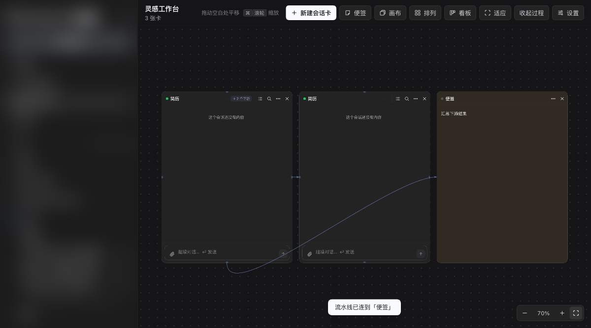 | 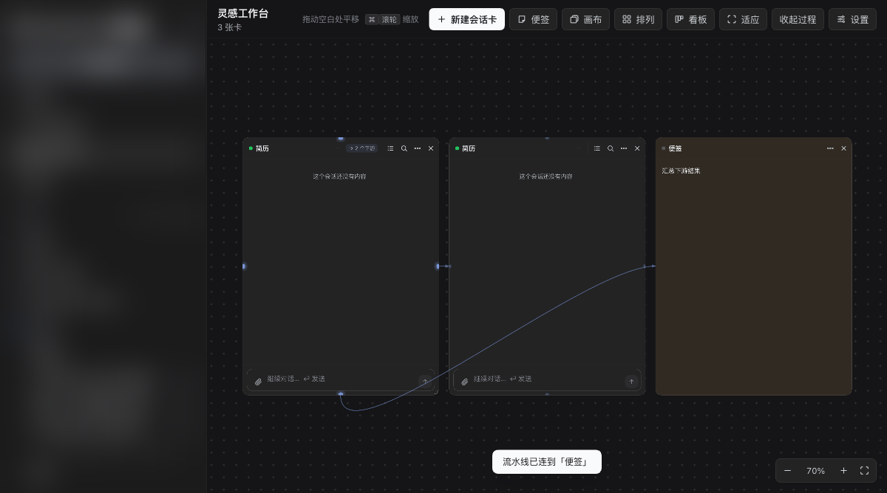 |

| 便签投递带标题和时间戳 | 便签可设为「只保留最新」 |
|---|---|
| 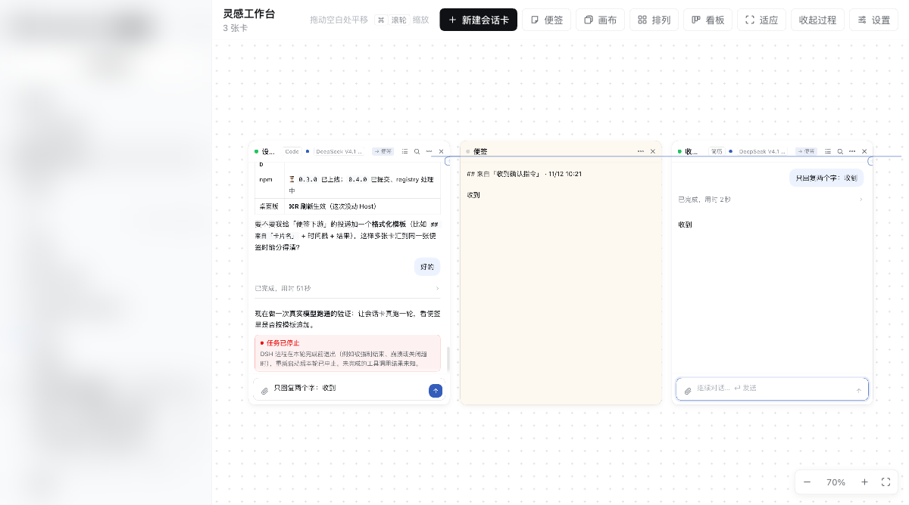 | 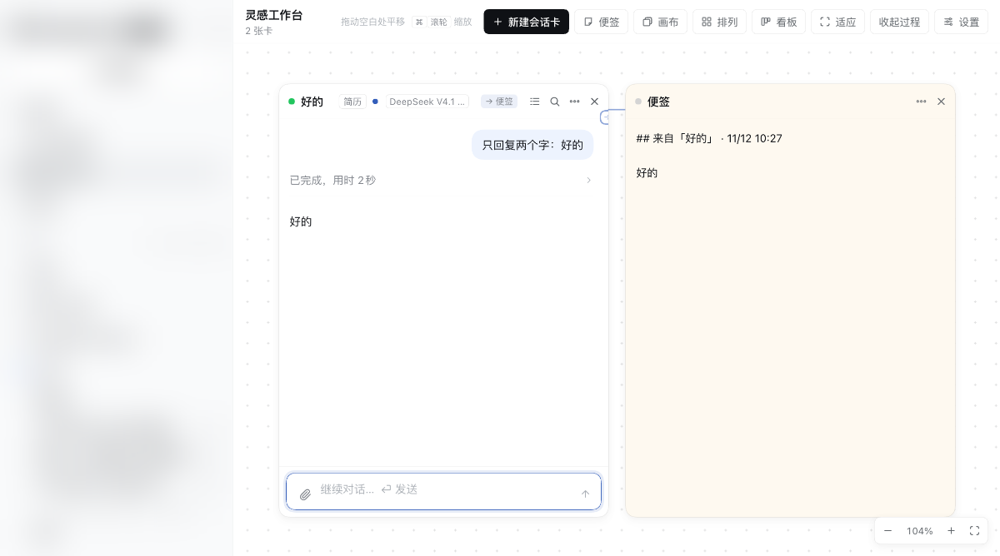 |

---

## 功能 / Features

**画布与卡片**
- 侧栏会话行的 `＋` 把会话加成卡片；侧栏点击行为不变
- 拖动 / 缩放 / 叠成一摞 / 双击居中 / 点空白平移 / ⌘+滚轮缩放
- **命名画布**：保存当前这面墙、切换回之前保存的画布、覆盖 / 删除；数据存 Host，刷新不丢
- **流水线**：卡片四条边的中点各有一个端口，从任意一条边拖线到另一张卡即建立；**一条卡可连多个下游**（扇出），下游可以是会话卡，也可以是**便签卡**（结果按 `## 来自「卡片名」 · 时间` 分块写入；便签可选「追加」或「只保留最新一段」）；点连线切换「自动发送 / 只填草稿」或删除
- 卡片头部操作常驻显示（流水线 / 大纲 / 搜索 / ⋯ / 关闭），次要操作用「⋯」收纳，窄卡片也不挤
- 便签卡（随手记）、钉住位置、未读圆点、复制为 Markdown、在原生会话打开

**与原生一致的会话渲染**
- 轮次折叠（桌面默认 `standard` 策略）、点开看步骤、步骤行活动图标 + 悬停变箭头
- Markdown（代码块带复制、表格、列表、引用）、失败横幅、思考强度两级菜单
- 排队消息条、插话（⌘+Enter）、图片/文件附件、提问回答

**多卡协作**
- 卡内搜索（高亮 + `1/N` 跳转）、轮次大纲
- 跨卡引用：把任意消息引用到另一张卡的输入框（带来源）
- 批量选择（⌘/Shift 点击）+ 叠放 / 对齐 / 铺开 / 关闭
- 排列策略：网格 / 按工作区 / 按最近活动
- 看板分栏：按状态 / 工作区 / 活跃度，退出恢复原位
- 流水线：上游卡一轮跑完，自动把结果送进下游卡；**在画布上直接拖线连接**，点线可切模式/删除（发送 or 只填草稿，3 跳防环）

**工程能力**
- Host 侧持久化 + SSE 多窗口同步（清站点数据可从 Host 恢复）
- 键盘可达：roving tabindex、方向键切卡、Shift+方向键移动、`/` `t` `o` `p` `c` `[` `]`
- 25+ 项 Playwright 回归断言：`npm run verify -- --url "<dsh url>"`

**双模式任务工作流（v0.13.5）**
- 顶部「画布 / 任务」切换：画布负责执行，任务中心负责目标、异常、交付和验收。
- 画布自动保存：新建空白画布前保存当前工作；未命名内容会要求确认；切回时恢复卡片、便签、连线、视口与输入草稿。
- 新建空白画布、设置重置与删除卡片都会同步清理连线，避免旧流水线残留。
- 任务中心：待处理优先、状态筛选、智能排序、进入现场、续做草稿、验收或返修；状态自动更新，无需手选。
- 流水线完成自动投递：支持多跳任务拓扑，按完整内容指纹去重，失败后延迟重试，并保存每个会话的运行状态。
- 会话整理：选择现有会话，本地规则或 AI 生成任务草案，用户勾选后再入库。
- 需求拓扑：按复杂度生成 4-12 个执行节点，保留草稿并仅启动根节点；自动补全缺失的整合依赖。
- 真实流转记录：等待投递、投递中、已发送、仅草稿、写入便签和失败均保存到任务事件。
- 任务、画布、流转事件共享真实会话引用，支持 Host/localStorage 持久化及多窗口 rev 同步。
- 便签默认 Markdown 渲染，支持预览 / 源码切换；预览便签按 Enter 直接进入源码编辑；图片与文件卡支持粘贴、拖入、选择和刷新恢复。
- 会话卡双击打开原生会话，便签双击切换预览 / 源码，文件卡双击打开预览；页面卸载与插件销毁时立即补保存，避免最后编辑丢失。
- 待处理提醒按真实数量显示，没有待审批、提问或排队消息时不显示空色块。
- 文件预览统一弹窗：图片、文本、HTML 沙箱、PDF、DOCX 文本、PPTX 文本，其他格式提供下载。
- 规划弹窗支持默认模型与可选模型目录，模型目录后台加载，不阻塞规划按钮。
- 任务详情显示节点级进度与完成数量，放在摘要之后、待处理之前。
- 工作区下拉选择与新建自动选中，避免新会话落入未分组；卡片内滚动不带动画布，卡片外才平移。
- 远程模型、提问接口为可选能力；缺失时画布和本地拓扑仍可使用。

---

## 安装 / Install

```sh
dsh plugin add dsh-plugin-inspiration-workbench
```

然后重启 DSH（或 ⌘R 刷新 Web UI），侧栏会出现「灵感工作台」。

直接从 GitHub 安装（不需要等 npm 版本）：

```sh
dsh plugin --profile <profile> add github:WilShi/dsh-plugin-inspiration-workbench
```

> **v0.1.0 有问题**：客户端 bundle 里写死了本地开发包名，安装后侧栏不出现入口。
> 请用 **0.1.1+**，或用上面的 GitHub 方式安装。

本地开发用链接安装：

```sh
git clone https://github.com/WilShi/dsh-plugin-inspiration-workbench.git
cd dsh-plugin-inspiration-workbench
npm install
npm run build          # 产出 lib/client.js
ln -s "$PWD" ~/.dsh/profiles/<profile>/node_modules/@local/dsh-inspiration-workbench
```

---

## 使用 / Usage

1. 侧栏悬停任意会话 → 点 `＋` → 变成卡片
2. 卡片顶部：模型 / 思考强度、工作区、搜索、大纲、流水线、钉住、复制、打开原生、关闭
3. 「新建会话卡」会先问工作区（画布没有"继承侧栏行工作区"的上下文）
4. 卡片底部输入框：Enter 排队、⌘+Enter 插话、回形针/粘贴/拖拽加附件
5. 「画布 → 任务」查看任务；「进入现场」返回同一画布；「续做」只生成草稿，不会自动发送
6. 「任务 → 整理会话」选择最近会话并生成草案；「规划需求」生成拓扑后，可仅创建或创建并启动
7. 工具栏画布菜单保存命名画布；旁边的「＋」新建空白画布，已保存工作不会被删除或停止

---

## 兼容性 / Compatibility

| DSH | 状态 |
|---|---|
| `0.2.2-rc.1` | ✅ 完整验证 |
| `0.2.1-rc.5` | ✅ 完整验证 |

只支持 **web 平台**（桌面版 / 浏览器版都包含 web UI）。远程模型、模型目录和提问接口缺失时会降级：核心画布、任务和本地拓扑可用，AI 规划与对应原生能力需要宿主提供接口。

---

## 已知限制 / Known limitations

- **内联审批做不到**：`approval/request` 是宿主的客户端瀑布事件，这一版只派发给内置包；
  插件从根作用域和会话作用域注册监听都收不到（实测注册成功、调用次数 0）。
  卡片会显示"这一版插件拿不到审批请求"，建议用「工作区内修改」访问模式让沙箱直接拒绝。
- 布局落盘在 `~/.dsh/inspiration-workbench-layout.json`，**全机共享**，未按 profile 隔离。
- 拖侧栏会话行到画布未实现（侧栏 drag payload 未公开）。
- 触屏/手势未做。

---

## 开发 / Development

```sh
npm install
npm run build     # esbuild → lib/client.js（产物随包发布，安装时无需构建）
npm test          # 任务模型、拓扑、AI 适配、Host 与 Store 单元/逻辑测试
npm run verify -- --url "http://127.0.0.1:<port>/?token=<token>"
npm run verify:task -- "http://127.0.0.1:<port>/?token=<token>"  # 双模式真实交互验收
npm run verify:ai -- "http://127.0.0.1:<port>/?token=<token>"    # 真实模型在线验收
npm run verify:pipeline -- "http://127.0.0.1:<port>/?token=<token>" # 会话间自动投递、补投递与状态自动验收
npm run verify:files -- "http://127.0.0.1:<port>/?token=<token>"    # 便签、文件卡、预览与恢复验收
npm run verify:models -- "http://127.0.0.1:<port>/?token=<token>"   # 模型选择、规划与节点进度验收
```

源码结构：

| 文件 | 作用 |
|---|---|
| `src/client/index.jsx` | 插件入口：locale、slot 注册、审批 hub |
| `src/client/board.js` | 画布状态机 + 卡片装配 |
| `src/client/render.js` | 会话内容渲染（轮次/步骤/工具/审批/附件） |
| `src/client/card-tools.js` | 复制、卡内搜索、轮次大纲、跨卡引用 |
| `src/client/popovers.js` | 模型菜单、排列、设置、工作区选择 |
| `src/client/sessions.js` | 会话适配层（retain / prompt / 投影读取） |
| `src/client/markdown.js` | Markdown 渲染 |
| `src/host/index.js` | Host 半：布局读写 + SSE 广播 |

---

## License

MIT © WilShi
