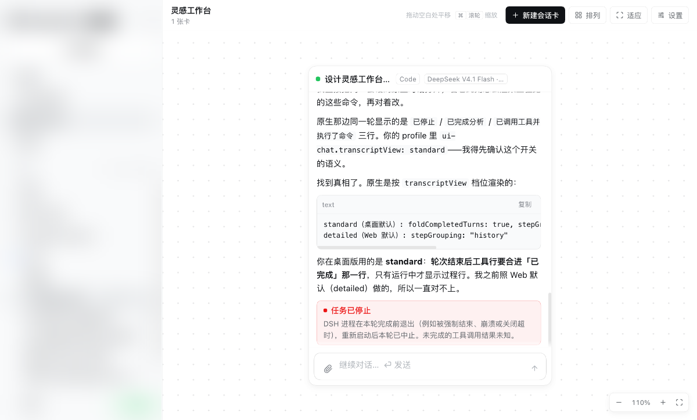
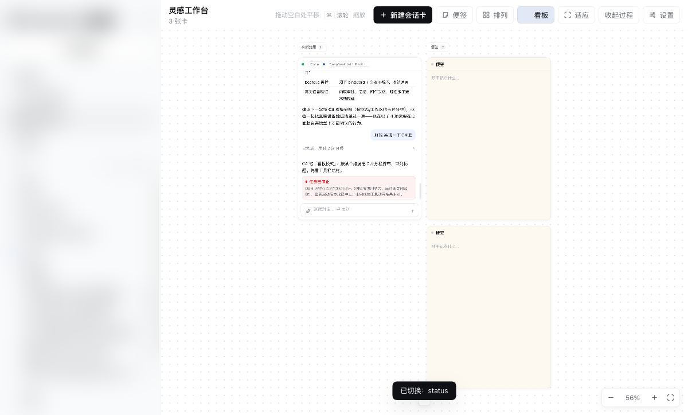
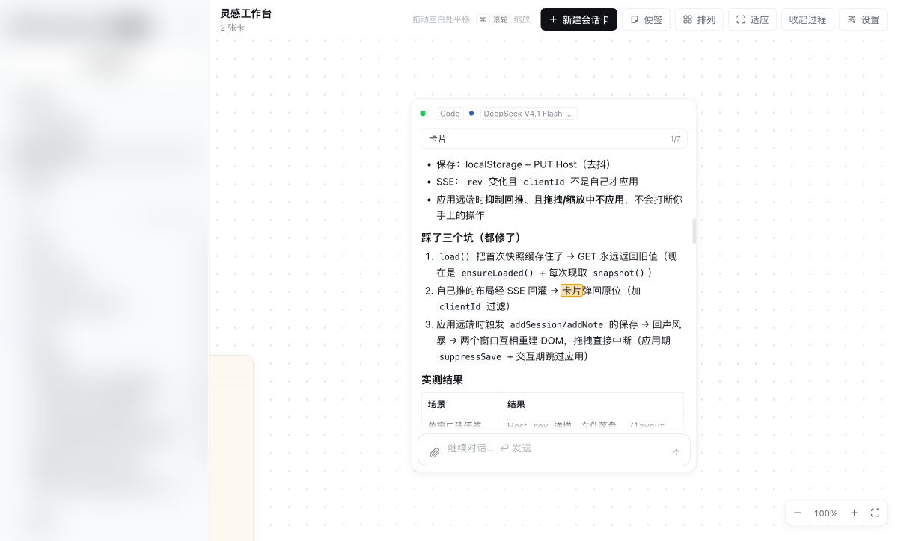
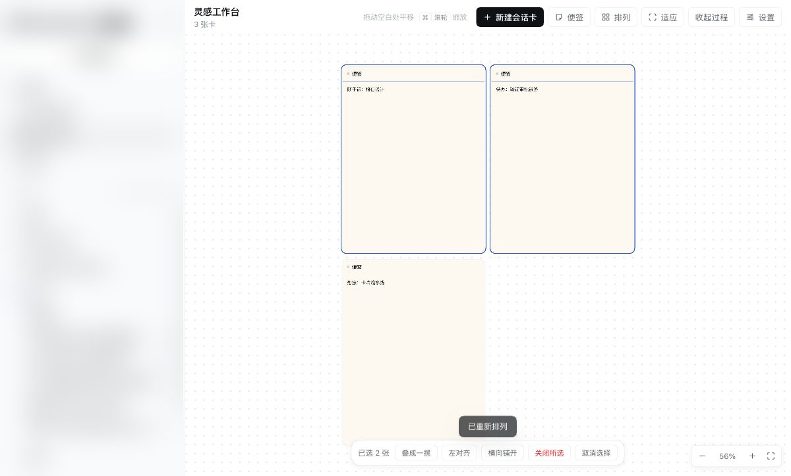
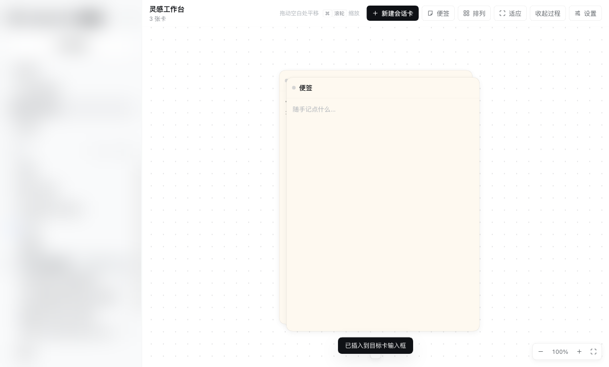
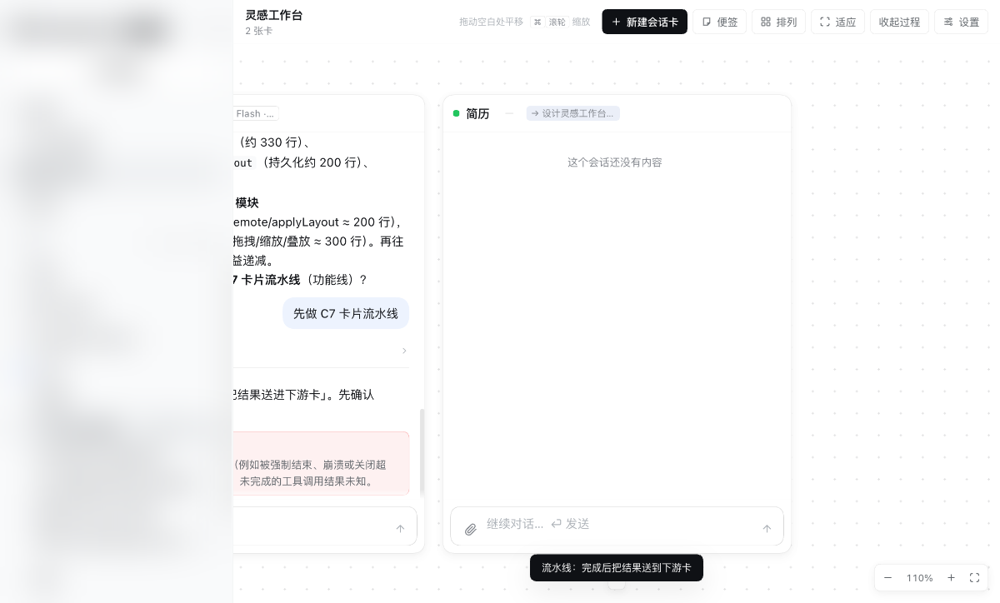
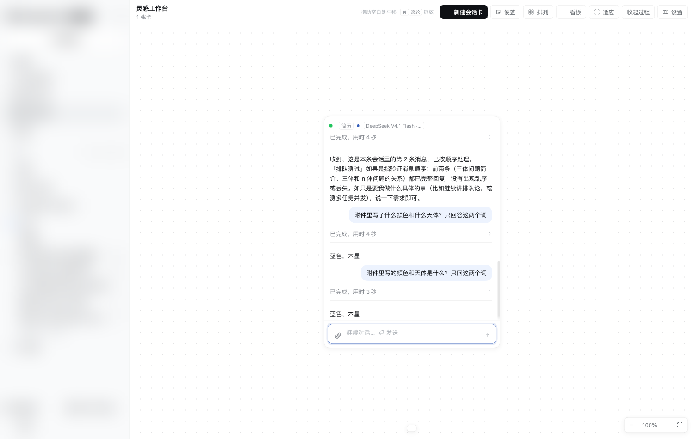
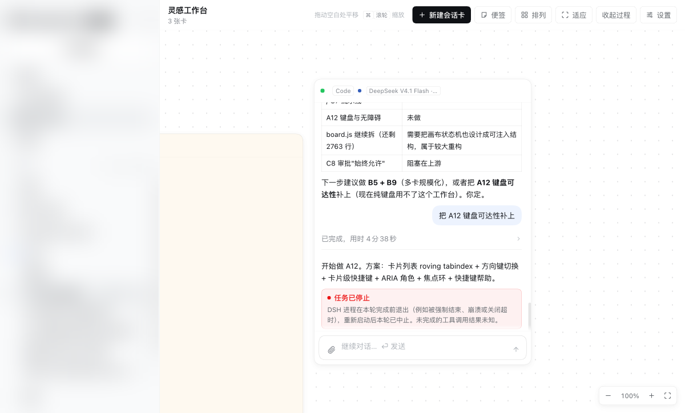

# Inspiration Workbench · 灵感工作台

**Open many DeepSeek Harness sessions side by side, as draggable cards on a free canvas.**
**把多个 DSH 会话同时摊在一个画布上，像便利贴一样拖动、叠放、对比。**

[](https://www.npmjs.com/package/dsh-plugin-inspiration-workbench)
[](./LICENSE)
[](https://github.com/awesome-dsh-plugin/awesome-dsh-plugin)

DSH 一次只能打开一个会话：想同时看三条线的进展，只能来回切标签、丢掉上下文。
这个插件把会话变成卡片：可以并排看、叠成一摞、按状态分栏、把一张卡的结论引用/流水线喂给另一张卡。

---

## 截图 / Screenshots

| 多卡 + 折叠轮次 | 分栏看板 |
|---|---|
|  |  |

| 卡内搜索 | 批量操作 |
|---|---|
|  |  |

| 跨卡引用 | 卡片流水线 |
|---|---|
|  |  |

| 附件（模型真实读到文件） | 键盘可达 |
|---|---|
|  |  |

---

## 功能 / Features

**画布与卡片**
- 侧栏会话行的 `＋` 把会话加成卡片；侧栏点击行为不变
- 拖动 / 缩放 / 叠成一摞 / 双击居中 / 点空白平移 / ⌘+滚轮缩放
- 便签卡（随手记）、钉住位置、未读圆点、复制为 Markdown、在原生会话打开

**与原生一致的会话渲染**
- 轮次折叠（桌面默认 `standard` 策略）、点开看步骤、步骤行活动图标 + 悬停变箭头
- Markdown（代码块带复制、表格、列表、引用）、失败横幅、思考强度两级菜单
- 排队消息条、插话（⌘+Enter）、图片/文件附件、提问回答

**多卡协作**
- 卡内搜索（高亮 + `1/N` 跳转）、轮次大纲
- 跨卡引用：把任意消息引用到另一张卡的输入框（带来源）
- 批量选择（⌘/Shift 点击）+ 叠放 / 对齐 / 铺开 / 关闭
- 排列策略：网格 / 按工作区 / 按最近活动
- 看板分栏：按状态 / 工作区 / 活跃度，退出恢复原位
- 流水线：上游卡一轮跑完，自动把结果送进下游卡（发送 or 只填草稿，3 跳防环）

**工程能力**
- Host 侧持久化 + SSE 多窗口同步（清站点数据可从 Host 恢复）
- 键盘可达：roving tabindex、方向键切卡、Shift+方向键移动、`/` `t` `o` `p` `c` `[` `]`
- 25+ 项 Playwright 回归断言：`npm run verify -- --url "<dsh url>"`

---

## 安装 / Install

```sh
dsh plugin add dsh-plugin-inspiration-workbench
```

然后重启 DSH（或 ⌘R 刷新 Web UI），侧栏会出现「灵感工作台」。

本地开发用链接安装：

```sh
git clone https://github.com/WilShi/dsh-plugin-inspiration-workbench.git
cd dsh-plugin-inspiration-workbench
npm install
npm run build          # 产出 lib/client.js
ln -s "$PWD" ~/.dsh/profiles/<profile>/node_modules/@local/dsh-inspiration-workbench
```

---

## 使用 / Usage

1. 侧栏悬停任意会话 → 点 `＋` → 变成卡片
2. 卡片顶部：模型 / 思考强度、工作区、搜索、大纲、流水线、钉住、复制、打开原生、关闭
3. 「新建会话卡」会先问工作区（画布没有"继承侧栏行工作区"的上下文）
4. 卡片底部输入框：Enter 排队、⌘+Enter 插话、回形针/粘贴/拖拽加附件

---

## 兼容性 / Compatibility

| DSH | 状态 |
|---|---|
| `0.2.2-rc.1` | ✅ 完整验证 |
| `0.2.1-rc.5` | ✅ 完整验证 |

只支持 **web 平台**（桌面版 / 浏览器版都包含 web UI）。

---

## 已知限制 / Known limitations

- **内联审批做不到**：`approval/request` 是宿主的客户端瀑布事件，这一版只派发给内置包；
  插件从根作用域和会话作用域注册监听都收不到（实测注册成功、调用次数 0）。
  卡片会显示"这一版插件拿不到审批请求"，建议用「工作区内修改」访问模式让沙箱直接拒绝。
- 布局落盘在 `~/.dsh/inspiration-workbench-layout.json`，**全机共享**，未按 profile 隔离。
- 拖侧栏会话行到画布未实现（侧栏 drag payload 未公开）。
- 触屏/手势未做。

---

## 开发 / Development

```sh
npm install
npm run build     # esbuild → lib/client.js（产物随包发布，安装时无需构建）
npm run verify -- --url "http://127.0.0.1:<port>/?token=<token>"
```

源码结构：

| 文件 | 作用 |
|---|---|
| `src/client/index.jsx` | 插件入口：locale、slot 注册、审批 hub |
| `src/client/board.js` | 画布状态机 + 卡片装配 |
| `src/client/render.js` | 会话内容渲染（轮次/步骤/工具/审批/附件） |
| `src/client/card-tools.js` | 复制、卡内搜索、轮次大纲、跨卡引用 |
| `src/client/popovers.js` | 模型菜单、排列、设置、工作区选择 |
| `src/client/sessions.js` | 会话适配层（retain / prompt / 投影读取） |
| `src/client/markdown.js` | Markdown 渲染 |
| `src/host/index.js` | Host 半：布局读写 + SSE 广播 |

---

## License

MIT © WilShi
